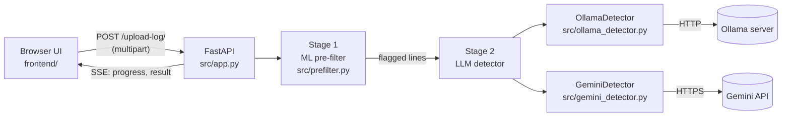

# Architecture

## Overview

The Log Anomaly Detector is a single FastAPI process that serves both the API and the static frontend. An analysis request uploads a log file and receives a stream of Server-Sent Events (SSE) as the file moves through a two-stage pipeline.

## Request lifecycle

1. **Validation** (`upload_log`). The model name, mode, speed and chunk percentage are checked. The file is read in 1 MB pieces and rejected with `413` once it exceeds `MAX_UPLOAD_MB` or `MAX_LINES`. If all `MAX_CONCURRENT_JOBS` slots are busy, the request gets `429`.
2. **Pre-flight check.** If an Ollama model will be used, the app confirms Ollama is reachable and the model is pulled *before* doing any work, so the user gets an actionable error immediately.
3. **Stage 1: ML pre-filter** (optional, needs more than `PREFILTER_MIN_LINES` non-empty lines). A fresh `LogPrefilter` is trained on the uploaded file in a worker thread, so the event loop stays responsive. It streams `prefilter_progress` events and keeps lines whose score is above the `PREFILTER_PERCENTILE` threshold.
   - In **ML Only** mode, the flagged lines are returned immediately with their scores.
4. **Stage 2: LLM.**
   - If Stage 1 ran, the detector's `explain_batch` is asked *why* each flagged line is anomalous. Every flagged line appears in the result even if the model skips it.
   - Otherwise `analyze_batch` scans every line, using the selected mode, and returns only the lines the model marks as anomalous.
5. **Result.** A final `result` event carries the anomalies, counts, and `failed_lines` (lines whose LLM call failed after retries).

If the client disconnects mid-stream, the running LLM task is cancelled.

## Modules

| Module | Responsibility |
|---|---|
| `src/app.py` | Routes, validation, security headers, the SSE pipeline, health and model endpoints |
| `src/config.py` | `Settings` (pydantic-settings), read from environment variables and `.env` |
| `src/prefilter.py` | `LogPrefilter`: feature extraction, SOM training, vectorised scoring |
| `src/ollama_detector.py` | `OllamaDetector`: async Ollama client, token-bucket rate limiter, retries for transient errors |
| `src/gemini_detector.py` | `GeminiDetector`: per-API-key rate limiting, shared cooldown on HTTP 429, exponential backoff, prompt cache, key validation |
| `src/llm_utils.py` | Shared parsing of LLM JSON output and conversion into result rows |

### Analysis modes (Stage 2 without pre-filter)

| Mode | Behaviour |
|---|---|
| `auto` | Chunks of 10% of the file (Ollama) or 10 lines (Gemini) |
| `line-by-line` | One request per line; the most thorough and the slowest. Not offered for Gemini because of rate limits. |
| `intensive` | Chunks of 20 lines, giving the model more context per line |
| `chunking` | Chunks of `chunk_percentage`% of the file (minimum 10 lines) |

In explanation mode (after the pre-filter), flagged lines are sent in batches of 250 (Ollama) or 125 (Gemini).

### Speed setting

`speed` controls how many LLM requests run in parallel:

| Speed | Ollama | Gemini |
|---|---|---|
| balanced | 2 | 1 |
| fast | 4 | 2 |
| max | 6 | 3 |

## Frontend

`frontend/` is plain HTML, CSS and JavaScript with no build step. It:

- loads the model list from `/api/models` and marks models that are not pulled yet,
- validates a Gemini key through `/api/validate-api-key` and stores it in the browser's `localStorage`,
- streams `/upload-log/` with `fetch` and a `ReadableStream`, updating the two progress bars,
- renders every piece of log content with `textContent`, never `innerHTML`, so malicious log lines cannot inject script.

## Security model

- The app has **no authentication**. Run it on a trusted network or behind an authenticating reverse proxy (see [deployment.md](deployment.md)).
- Responses carry a strict Content-Security-Policy, `X-Frame-Options: DENY`, `X-Content-Type-Options: nosniff` and `Referrer-Policy: no-referrer`.
- CORS is off by default (same-origin only).
- Gemini keys entered in the UI are sent with each request and held in memory only (rate-limiter and cache state are keyed by a SHA-256 hash of the key). They are never written to disk or logs on the server.
- Uploaded logs are processed in memory and not stored. When a Gemini model is selected, log lines are sent to Google's API.
